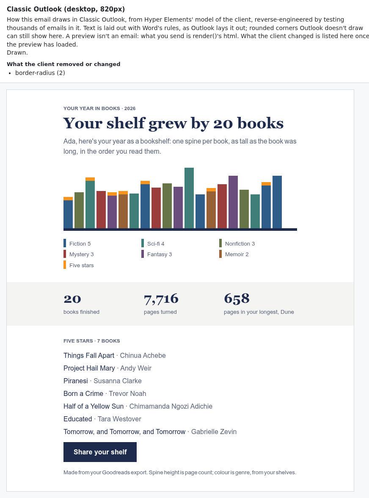
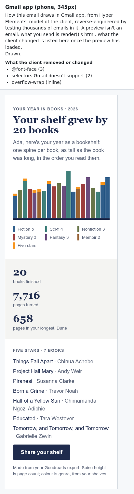
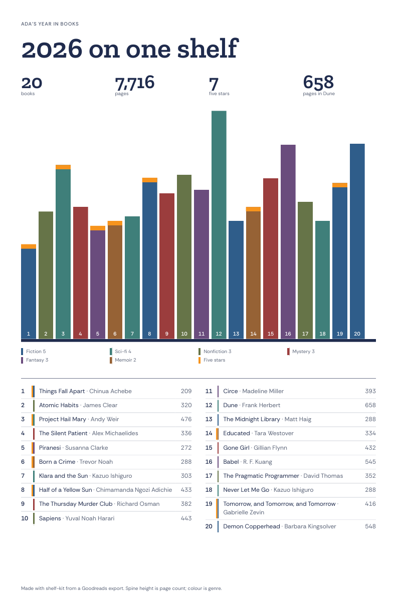
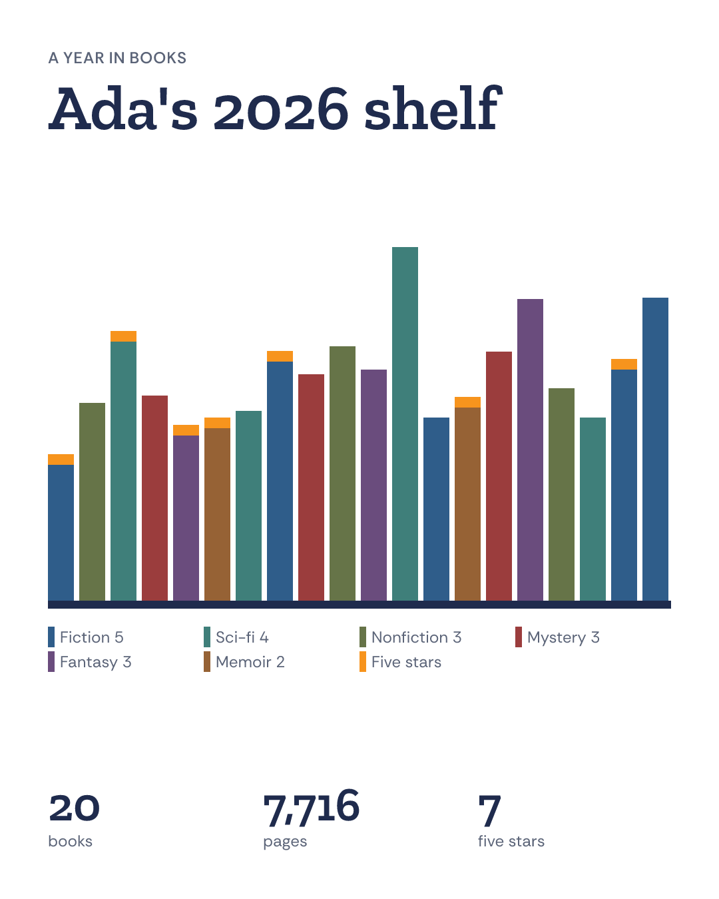

# Shelf Kit

Your reading year as a bookshelf. Export your library from Goodreads, run one command, and get:

- **An email**: "Your shelf grew by 20 books", with the shelf drawn in real table cells, so it looks the same in classic Outlook, Gmail and Apple Mail
- **A tabloid poster PDF** to print and pin up, with every spine numbered and a key to the titles
- **A share card** (1080 × 1350 PNG and SVG) for a story or a group chat

One spine per book, in the order you read them. A spine is as tall as the book was long, coloured by genre, and a five-star book gets an amber band at the top, like a bookmark.

All three are built with [Hyper Elements](https://hyperelements.dev) (`@hyper-elements/react`) and share one `Bookshelf` element.

| Email, classic Outlook | Email, Gmail app | Poster PDF | Share card |
|---|---|---|---|
|  |  |  |  |

The email screenshots come from Hyper Elements' email-client emulator (`@hyper-elements/email-clients`).

## Why

Year-in-books recaps are everywhere in December, and almost all of them are a screenshot inside an app. A chart in an email is usually an image too, because bar charts need CSS that Outlook ignores. This kit draws the chart with the layout every client agrees on: a row of fixed-width columns, bottom-aligned on a plank. It holds up in classic Outlook on Windows and in the Gmail app on a phone, where the spines narrow to fit instead of stacking.

## Use your own reading year

1. On Goodreads: **My Books → Import and export → Export Library**, then download the CSV.
2. Run:

```bash
CSV=path/to/goodreads_library_export.csv YEAR=2026 READER=Sam npm run render
```

On Windows PowerShell:

```powershell
$env:CSV="path\to\goodreads_library_export.csv"; $env:YEAR="2026"; $env:READER="Sam"; npm run render
```

`READER` is the name on the poster and the card (the email greets each reader with a `{{first_name}}` merge tag instead). `SHARE_URL` sets where the email's button goes.

`src/csv.ts` reads the export (quoted fields, commas and line breaks inside reviews) and keeps the books on your **read** shelf with a **Date Read** in that year. The genre comes from your own shelf names, each judged on its own: `sci-fi` or `science fiction` colour a spine teal, `fantasy` or `mythology` plum, `thriller`, `mystery` or `crime` brick, `memoir` or `biography` tan, `true-crime`, `history`, `philosophy`, `self-help` and the like olive, and `young-adult`, `poetry` or `literary` blue. Spaces, hyphens and underscores count the same. When a book is on several genre shelves, the more specific one wins (the full list is at the top of `src/csv.ts`). Anything unmatched is grey. A book with no page count on Goodreads is left off the shelf, with a warning naming it. An empty file, a file that isn't a Goodreads export, a year with no books or a `YEAR` that isn't a year stops with one plain sentence saying which.

The sample in `data/` is 20 real books read by a made-up reader, Ada, plus a to-read book and a 2025 book that are correctly left out.

StoryGraph exports aren't supported: they don't include page counts.

## How it scales

The poster and card work out the spine width and height from the number of books. A short year gets wide spines that span the page; past about 27 books (poster) or 29 (card) the books go onto more shelves and the spines get shorter, so it stays on the page. Past 24 books the poster moves its title key to a second page, in three columns past 60, and runs on to further pages 66 books at a time. The email has one limit: from about 110 books it passes 100 KB, where Gmail clips it behind a "View entire message" link, and `emailClients()` warns. Tested with years of 1, 20, 65 and 120 books, a year with no five-star books (the band leaves the key and the five-star list leaves the email) and series titles like "The Way of Kings (The Stormlight Archive, #1)", which the stats shorten to "The Way of Kings".

## The look

Navy on white. The ground is plain white so the genre colours read true; navy (`#1f2b4d`) is the type and the shelf plank; amber (`#f7941d`) is used only for the five-star band, never for text. Seven muted genre colours sit together without any one shouting, and every one holds the poster's white spine numbers at 4.5:1 or better. Zilla Slab, a slab with a library's warmth, sets the headings and numbers; Rethink Sans sets everything else. Contrast on white: navy 13.9:1, the muted grey 5.9:1.

## How Hyper Elements is used

| Feature | Where | What it does here |
|---|---|---|
| `defineTheme` + `Register` | `src/theme.ts` | One typed theme; every `token()` and `apply` name is checked by `tsc`, including the seven genre colours |
| `formats` | `src/theme.ts` | Type sizes per root: poster sizes for the tabloid `document`, inbox sizes for `email`, big sizes for the `canvas` card |
| Named styles + `Heading` levels | `src/theme.ts` | `label` (the spine numbers), `caption`, `muted` and `stat`, shared by all three; level 1 is the slab title (smaller on phones), level 2 the small muted caps label |
| `defineElement` | `src/elements.tsx` | Five custom elements with typed, validated props: `Bookshelf` (books with pages, genre and five stars; spine width, gap, heights, books per shelf, numbered spines, phone spine width), `ShelfKey`, `TitleKey`, `Stat` and `ShelfHeader` (with a fit-to-one-line title the card uses) |
| `Row` + fixed-width `Column`s | `Bookshelf` | `stackOnMobile={false}`, `alignItems: "end"`, a navy bottom border as the plank, a top border as the five-star band. Phone styles narrow the spines (22px to 11px) in the Gmail app |
| `Table` | `ShelfKey`, `TitleKey` | The key and the title list line up in columns in every client; a paper-coloured border keeps the little spine swatches apart |
| `MergeTag` | `ShelfHeader`, `src/email.tsx` | "{{first_name}}, here's your year as a bookshelf", filled by your sending service |
| Scoped `tokens` | `src/email.tsx` | The stats band swaps the background token instead of restyling its children |
| `Email` + `Button` hover | `src/email.tsx` | 600px email with a preview line, the shelf, the key, three numbers, the five-star list and a "Share your shelf" button |
| `render` + `emailClients()` | `scripts/render-email.tsx` | Renders once and checks the email against 11 clients |
| `renderInEmailClients` | `scripts/render-email.tsx --preview` | Previews the design (with `mergeTag` filling the name) in classic Outlook, the Gmail app and Apple Mail, light and dark |
| `Document` + `PageFooter` + `PageBreak` + `PageNumber` + `renderPdf` | `src/pdf.tsx`, `scripts/render-pdf.tsx` | A tabloid poster, with a second page (and "Page 1 of 2") only when the key needs it; `validate` runs first and stops on an invalid design |
| `Canvas` + `fit` | `src/card.tsx` | "Ada's 2026 shelf" shrinks to fit one line, so a long name never wraps |
| `layoutImage` + `renderImage`, `strict` | `scripts/render-card.tsx` | Measures the card first; a missing glyph or anything past the canvas fails the build |

### What the client checks found

`emailClients()` reports no errors or warnings, and five notes, all cosmetic: Outlook, Gmail, Yahoo and AOL don't load web fonts, so the email falls back to Georgia and Arial (Rockwell where it's installed); classic Outlook skips letter spacing on the two small labels and has no button hover; the Gmail app on non-Google accounts keeps desktop styles on phones. The previews add what each client strips: classic Outlook squares the button's corners, and the Gmail app drops the `@font-face` rules. The shelf itself needs nothing removed in any client, and on a phone the spines narrow (22px to 11px) so 21 books fit the Gmail app's 297px.

In the plain-text version, the key's swatch cells come out as empty table columns.

## Run it

Requires Node 20 or later.

```bash
git clone https://github.com/cipoklean/shelf-kit.git
cd shelf-kit
npm install

npm run render          # email, poster and card into out/, from the sample
npm run preview:email   # also writes email-client previews to out/email/previews/
```

| Command | Writes |
|---|---|
| `npm run render:email` | `out/email/shelf.email.html` and `.txt` |
| `npm run preview:email` | The above, plus one HTML preview per client in `out/email/previews/` (not committed; open them in Chrome or Chromium) |
| `npm run render:pdf` | `out/shelf-poster.pdf`, `out/shelf.print.html` |
| `npm run render:card` | `out/shelf-card.png`, `out/shelf-card.svg` |
| `npm run typecheck` | Type-checks everything |

Every command takes `CSV`, `YEAR`, `READER` and `SHARE_URL`.

## Project layout

```
src/
  types.ts      Book, Genre, ReadingYear
  csv.ts        CSV parser and Goodreads reader, shelf names to genres
  shelf.ts      spine heights, shelves, stats, plurals and title shortening
  data.ts       loads the CSV for a year (CSV, YEAR, READER, SHARE_URL)
  theme.ts      the shared, typed theme
  fonts.ts      web fonts for the email and print HTML
  elements.tsx  Bookshelf, ShelfKey, TitleKey, Stat, ShelfHeader
  email.tsx     Email root
  pdf.tsx       Document root
  card.tsx      Canvas root
scripts/        one render script per output
data/           sample Goodreads export
fonts/          Zilla Slab and Rethink Sans (SIL OFL 1.1)
out/            rendered outputs, committed so you can look without installing
docs/           README screenshots
```

## Licence

Code: MIT. Fonts: Zilla Slab and Rethink Sans, SIL Open Font License 1.1. The reader Ada and the share URL are made up; the books are real.
